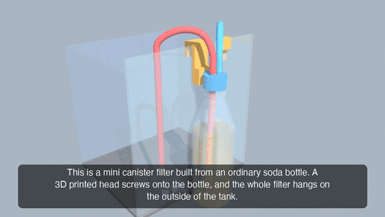
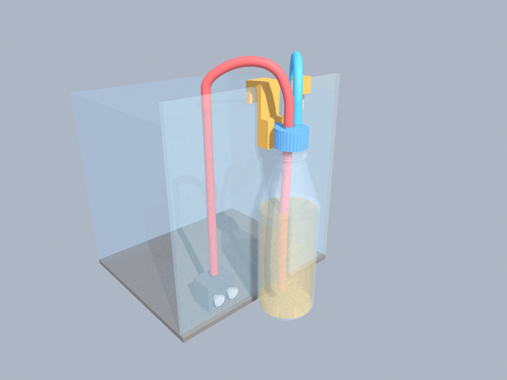
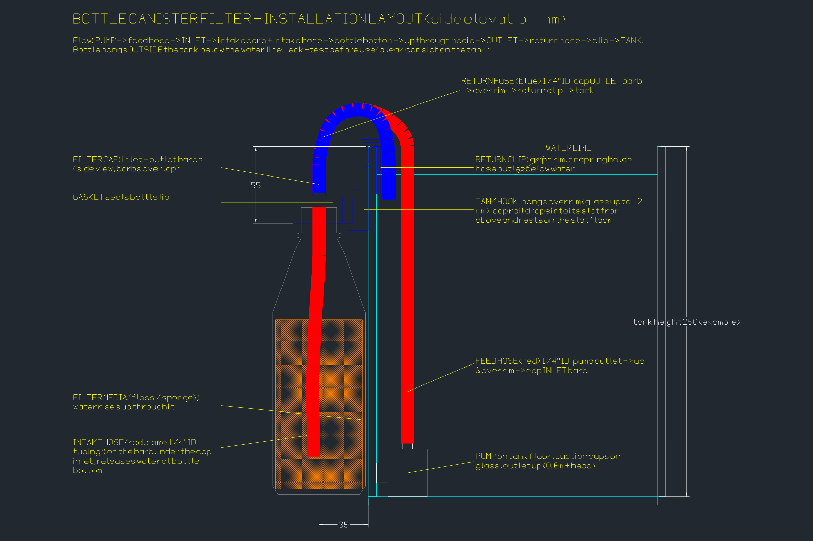
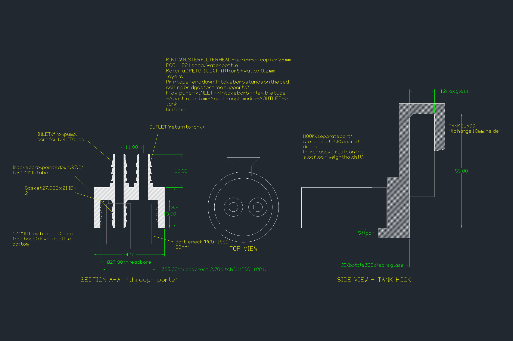
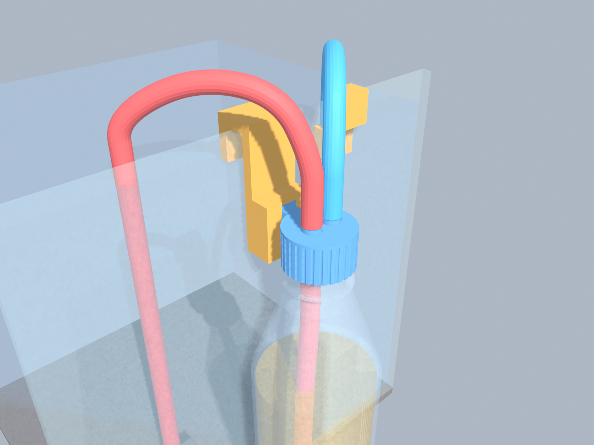
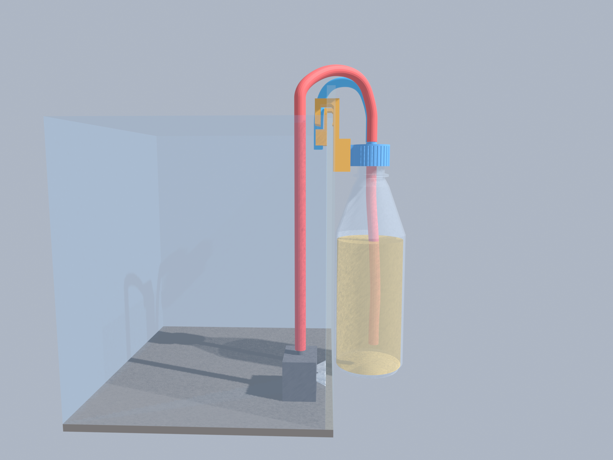

# filter-design: Bottle Canister Filter

A 3D-printable **mini canister filter for small aquariums** that screws onto an ordinary 28 mm
soda or water bottle. A small pump in the tank pushes water into the bottle. A second barb under the cap holds a
length of flexible tubing that sends it to the bottom, so it has to rise through **all** of the filter media before it returns to the tank.
The whole system is sealed and runs under pressure, like a full-size canister filter.

[](media/filter_flythrough_480p.mp4)

▶ **Narrated flythrough:** [480p, 1.6 MB](media/filter_flythrough_480p.mp4) · [720p, 7.9 MB](filter_flythrough.mp4)
(83 s, Kokoro narration, captions included)

## How it works



1. A **submersible pump** sits on the tank floor, stuck to the glass.
2. The **feed hose** (red) goes up over the rim to the filter head's **inlet** barb.
3. Inside the bottle, an **intake hose** (the same tubing, pushed onto a barb under the inlet) carries the water to the bottom.
4. The water rises up through the **filter media** (floss / sponge) and leaves through the **outlet** barb.
5. The **return hose** (blue) goes back over the rim, held in place by the **return clip**.
6. The whole filter hangs on the outside of the tank from the **tank hook**: hang the hook on the rim, then lower the cap's rail into the hook's slot from above.



## Printed parts

| Part | File | Material / orientation |
|------|------|------------------------|
| Filter head (cap): PCO-1881 thread, inlet + outlet barbs for 1/4" ID tube, intake barb underneath, gasket seat, hook rail | [`bottle_filter_cap.stl`](bottle_filter_cap.stl) | PETG, 100% infill, open end down |
| Tank hook: hangs on the rim; the cap's dovetail rail drops into its slot from above and rests on the slot floor. Fits glass up to 12 mm | [`bottle_filter_tank_hook.stl`](bottle_filter_tank_hook.stl) | PETG, flat as exported |
| Return clip: grips the rim, snap ring for 3/8" OD hose | [`bottle_filter_return_clip.stl`](bottle_filter_return_clip.stl) | PETG, flat as exported |
| Gasket: 27.5 OD × 21 ID × 2 | [`bottle_filter_gasket_tpu.stl`](bottle_filter_gasket_tpu.stl) | TPU 95A (or cut from rubber sheet) |



| Close-up | Side view |
|---|---|
|  |  |

## What else you need
See **[PARTS_LIST.md](PARTS_LIST.md)**. In short: a 28 mm-neck soda bottle, a 3 to 6 W mini pump
with at least 0.6 m of head, about 1.7 m of 1/4" ID × 3/8" OD tubing (including ~20 cm for the intake hose inside the bottle), filter media, and a gasket.

## Customising
Every printed part is generated by **[`build_filter_cap.py`](build_filter_cap.py)**. Change the
constants at the top and re-run it:

```bash
pip install manifold3d numpy trimesh
python build_filter_cap.py
```

| Parameter | Default | What it controls |
|---|---|---|
| `INTAKE_HOSE_LEN` | 180 | Intake hose length below the cap (mockup only). Cut your tubing to bottle height minus ~20 mm |
| `PORT_IN_X`, `PORT_OUT_X` | -4.8, 7.0 | Port positions. The inlet sits close to the axis so the intake hose fits through the neck |
| `CLIP_GLASS` | 6 | **Set to your tank's glass thickness** before printing the return clip |
| `GLASS_T` | 12 | Thickest glass/rim the hook fits over |
| `HOOK_H` | 55 | How far below the rim the cap hangs |
| `BOTTLE_R` | 33 | Bottle body radius (keeps the bottle clear of the glass) |
| `R_BORE`, `R_CREST` | 13.95, 12.95 | Thread fit. Adjust in 0.1 mm steps if it's too tight or loose |

## Before you use it
- **Test the thread first:** the bottle-neck dimensions come from the PCO-1881 spec and haven't
  been measured on a real bottle yet. Print the cap and check the fit before printing the rest.
- **Leak-test for 24 hours** over a sink. The bottle hangs below the tank's water line, so a leak can
  **siphon water out of the tank** even with the pump off.

## Repository layout
```
build_filter_cap.py        source of truth for all printed geometry -> STLs
*.stl                      printable parts
bottle_filter_cap.dxf      CADCraft engineering drawing (section, top view, hook)
PARTS_LIST.md              non-printed bill of materials
mockup/                    full-system 3D scene (GLB), install layout (DXF), renders, video pipeline
media/                     README video preview (GIF) and compressed 480p video
design-notes/              detailed design notes: specs, decisions, toolchain, verification, open issues
```

Designed with CADCraft (2D drawings), manifold3d (3D geometry), Blender (renders) and Kokoro (narration).
